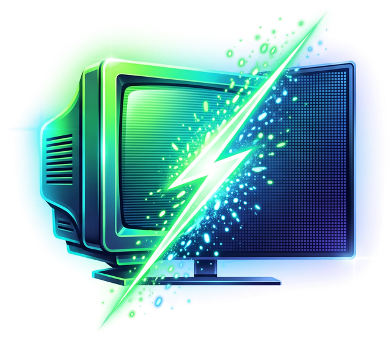
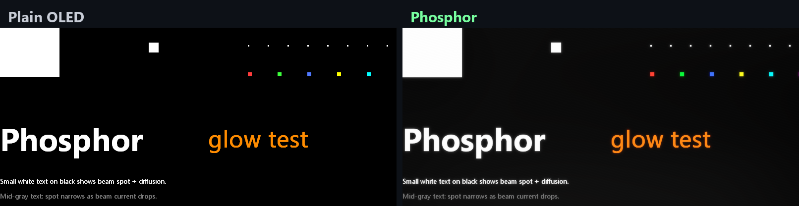
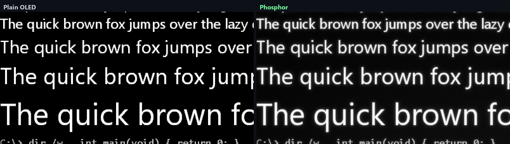
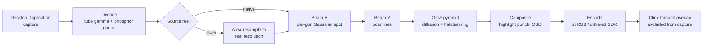

<p align="center">
  
</p>

<h1 align="center">Phosphor</h1>

<p align="center">
  <b>Make a 4K OLED look like a high-end CRT, across the whole desktop.</b><br>
  A physically based CRT model sized in millimetres: Gaussian beam, phosphor glow, faceplate halation,
  tube gamma and phosphor colours. It keeps the tube's strengths and leaves out its defects.
</p>

<p align="center">
  
  
  
  
  
</p>

---

Phosphor runs as a click-through overlay. It captures the monitor, runs it through a model of a CRT
tube, and draws the result on top. That covers the desktop, browsers, video, and games in borderless mode.

The target is a hypothetical **4K Diamondtron**: a flat aperture-grille tube with the beam, glow and
colour of a high-end PC CRT, at the full resolution of a modern panel. Defects like flicker, geometry
errors, convergence errors and dimming are left out.

<p align="center">
  <br>
  <sub>Highlights on black. Beam bloom, phosphor glow, and the faceplate halation ring around bright objects.</sub>
</p>

<p align="center">
  <br>
  <sub>Small text, 3× zoom. Round Gaussian beam spots instead of a hard pixel grid.</sub>
</p>

## Features

| | |
|---|---|
| **Gaussian beam** | Each colour gun draws a soft spot whose width follows its own beam current, so bright detail blooms the way a real tube's does. The spot is integrated exactly over every panel pixel, so total brightness is conserved. |
| **Glow from within** | A faint skirt around every spot, plus phosphor-layer diffusion. |
| **Faceplate halation** | A ring of light around highlights, derived from glass thickness and total internal reflection in the faceplate. It has the real dark gap before the ring. |
| **Tube response** | A pure power-law gamma (2.4 by default) with true black, Diamondtron / Trinitron / P22 phosphor primaries, and a 6500 K or 9300 K white point. |
| **Physical units** | Beam, glow and halation are specified in **millimetres on the glass** and converted using the panel size read from EDID. The look matches a real tube at the same viewing distance on any monitor. |
| **Any resolution, cleanly** | Lower-resolution content is redrawn as real scanlines at its true resolution instead of being blurrily upscaled. That's how a CRT shows 1080p, 720p or 240p. |
| **Auto resolution detection** | Detects when fullscreen video or a game was stretched from a lower resolution, and switches to it automatically. See [below](#auto-resolution-detection). |
| **HDR aware** | Highlight punch (small bright areas go above full-field white, like a CRT whose ABL only limits large areas), scRGB output, and dithering in the panel's own PQ signal so dark gradients stay smooth. |
| **QD-OLED fringe fix** | Each colour is drawn at its emitter's physical position inside the pixel, calibrated by eye, to cancel the red/green fringing of triangular subpixel layouts. |
| **On-screen help** | Every hotkey shows a panel saying what changed and what to look for. A split view compares the raw OLED with Phosphor side by side. |
| **Hot reload** | Edit `phosphor.ini` or `shaders/crt.hlsl` and the change is live on save. |

### Deliberately not emulated

Flicker, geometry and pincushion distortion, convergence errors, corner defocus, purity and moiré,
ABL dimming of bright scenes, phosphor smear, noise, glass reflections, and damper wires.

## Requirements

- Windows 10 2004 or newer (Windows 11 recommended)
- A Direct3D 11 GPU
- Built for 4K, high refresh, HDR-capable OLED panels, but works on any monitor
- Visual Studio 2022/2026 with C++ tools, and CMake 3.20+, to build

## Build

```bash
cmake -S . -B build -A x64
cmake --build build --config Release
```

The exe is copied to `bin/phosphor.exe`. It finds `phosphor.ini` and `shaders/crt.hlsl` in the project
folder, so you can edit them live while it runs.

## Setup

1. **Turn on Windows HDR** and run the *Windows HDR Calibration* app. Set *SDR content brightness* so white
   matches your taste (a CRT is about 100–150 nits). HDR gives Phosphor the headroom for highlight punch.
2. **Monitor colour mode:** sRGB, or let Windows HDR handle colour. Wide-gamut modes like Display P3
   oversaturate everything.
3. **Turn ClearType off** (grayscale text smoothing). A CRT has no subpixels.
4. **Games:** use borderless or windowed fullscreen. Exclusive fullscreen draws over the overlay.
5. **RivaTuner (RTSS) users:** exclude `phosphor.exe` (*Application detection level: None*). Otherwise
   RTSS hooks the overlay, draws its counter on it, and may frame-limit it.

## Hotkeys

All hotkeys are **Ctrl + Alt + Shift +** a key:

| Key | Action |
|---|---|
| **Q** | Quit (panic key) |
| **C** | Phosphor on / off |
| **S** | Split compare: left half raw OLED, right half Phosphor |
| **P** | Next look |
| **B** | Cycle beam sharpness |
| **A** | Auto resolution detection on / off |
| **L** | Cycle subpixel layout (colour fringe fix) |
| **M** | CRT motion (rolling scan), experimental |
| **G** | A/B the glass veil + analog softness |
| **R** | Reload config + shader |

The tray icon has the same functions plus a look menu.

## Looks

| Look | Character |
|---|---|
| **Best of both** *(default)* | Sharp 4K beam with strong glow from within and bright small highlights |
| 4K Diamondtron | The cleanest, crispest tube |
| VX1120 match | Softer beam, closer to a real 1600×1200 tube |
| 4K Diamondtron 9300K | The cool bluish white most PC CRTs shipped with |
| 1440p / 1080p / 1200p content | Redraws content of that resolution as real scanlines |
| 480p / 720p video | For fullscreen low-res video |
| 480 / 240 line content | Old PC games and console emulators, with visible scanlines |
| Softer beam, With visible grille, Tube response only | For comparison and taste |

Every look is a section in `phosphor.ini`. Copy one and tune it. Every key is documented in the file.

## Auto resolution detection

Every common scaler (nearest, bilinear, bicubic, Lanczos) builds a stretched image out of one fixed
kernel per source pixel. Twice a second, Phosphor samples 32 rows and 32 columns of the screen. On a
background thread, it least-squares fits them with each scaler kernel on each candidate source grid.

At the true source resolution the fit is close to exact. At the next lower candidate the error jumps,
because the grids no longer line up. Native content shows a smoothly rising error curve with no dip,
so it is left alone.

The decision only switches after three identical results in a row, and falls back to native when unsure.

- **Works with:** fullscreen browser video and games stretched with standard scalers, from 1440p down to 240p.
- **Stays native on purpose:** DLSS, FSR and TAA upscaling rebuild real detail and have no fixed-kernel
  fingerprint. Video in a window isn't detected either.
- **Overrides:** a look or a per-game profile with a fixed `source = WxH` always wins:

```ini
[app eldenring.exe]
source = 1920x1080
```

## CRT motion (experimental)

**Ctrl+Alt+Shift+M** turns on a Blur Busters-style rolling scan. Each CRT frame is drawn as slices across
several panel refreshes, using HDR headroom and an exact exponential phosphor afterglow, and timing is
locked to DWM's composition clock.

On a 240 Hz panel the slices are thick, so most people will see bands when their eyes move. That's an
inherent limit of 240 Hz, not of the method. It's off by default.

## How it works



Every optical step conserves total light, so the average brightness of an image is unchanged to
within 0.4%. The pipeline costs about 2 ms per frame on an RTX 3080 at 4K, and only runs when the
screen changes.

## Command-line tools

```bash
phosphor --image in.png out.png [--preset "Best of both"] [--source 1920x1080] [--bench 300]
phosphor --pattern chart.png 3840 2160     # calibration chart
phosphor --detect frame.png                # run the resolution detector on an image
phosphor --list                            # list displays
```

`--bench` also logs per-pass GPU timings.

## Known limits

- **Latency:** about one refresh of added latency (~4 ms at 240 Hz), the cost of capture-and-overlay.
- **VRR:** G-Sync / FreeSync can't engage under the overlay.
- **Exclusive fullscreen:** those games draw over the overlay.
- **Physics a panel can't reproduce:** the OLED's own subpixels stay visible up close, and the depth of a
  CRT's faceplate and the spectrum of real phosphors can't be recreated on a flat panel.
- **Motion clarity:** true CRT motion clarity needs a much faster panel. See [CRT motion](#crt-motion-experimental).

## Credits

- Rolling-scan approach after the [Blur Busters CRT Beam Simulator](https://github.com/blurbusters/crt-beam-simulator)
  (Mark Rejhon and Timothy Lottes, MIT). Phosphor's implementation is its own.

## License

[GPL-3.0](LICENSE)
